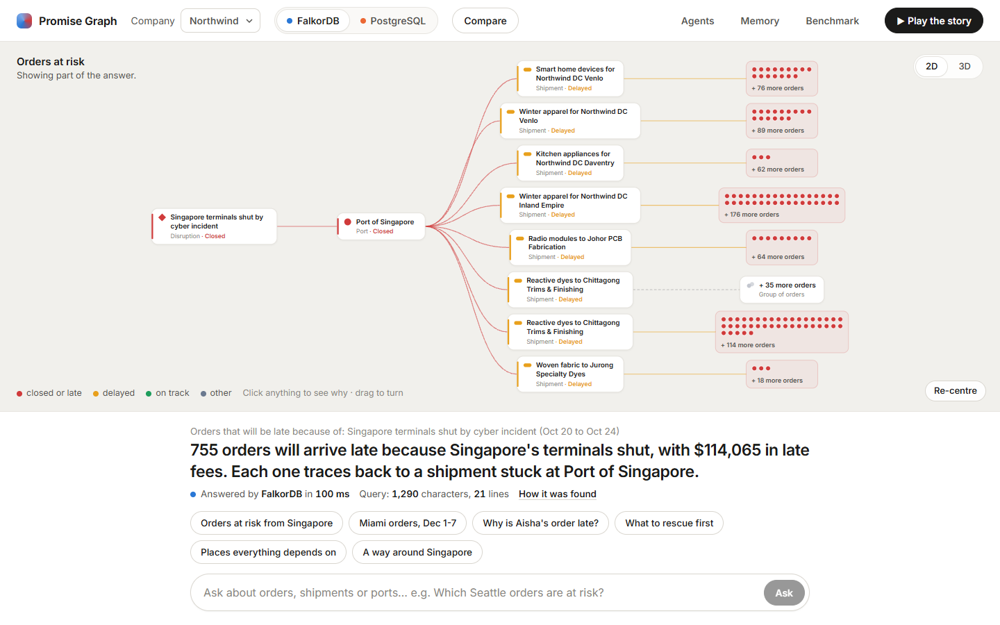
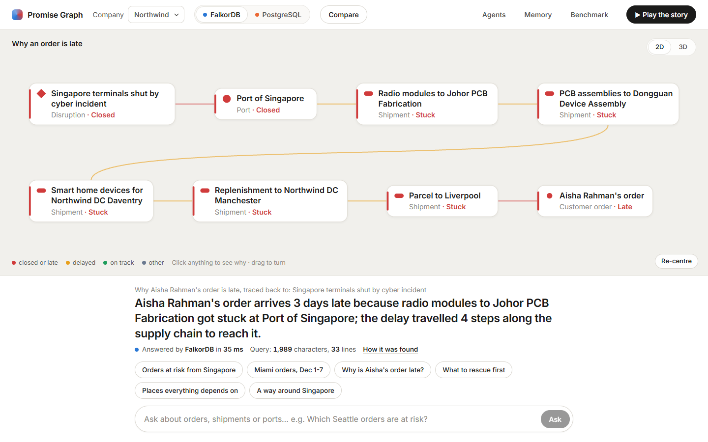
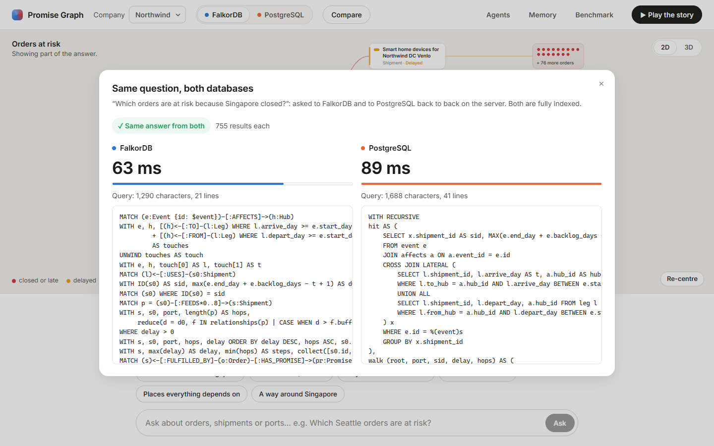
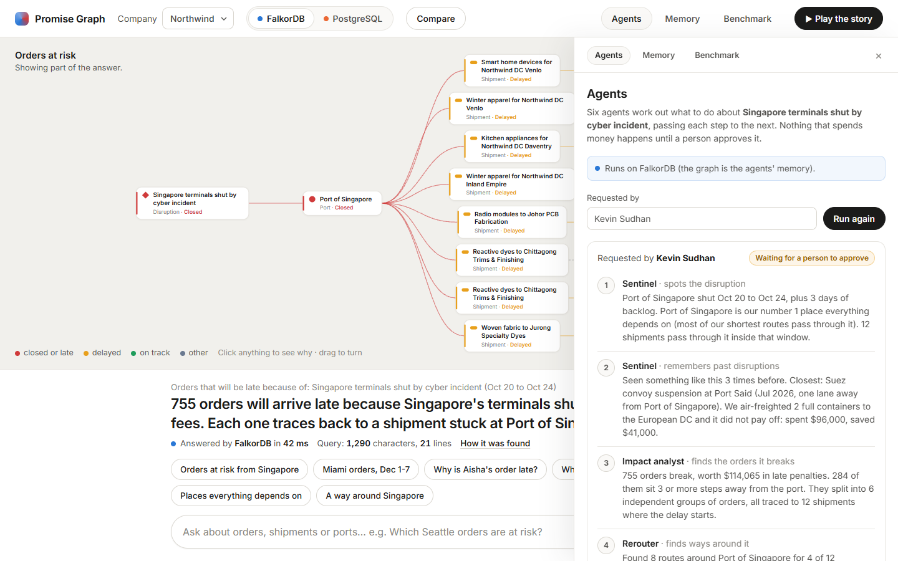
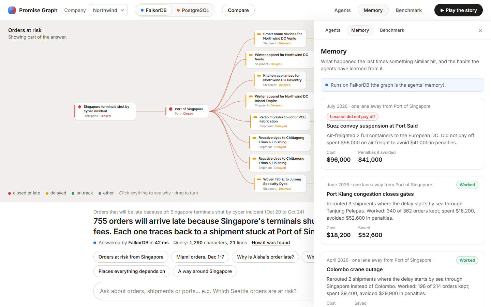
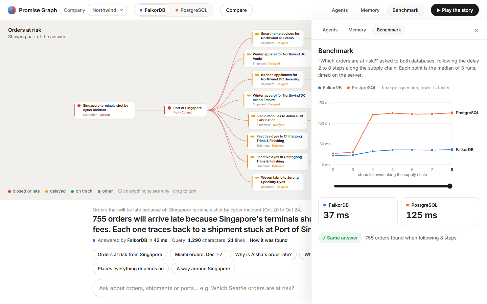
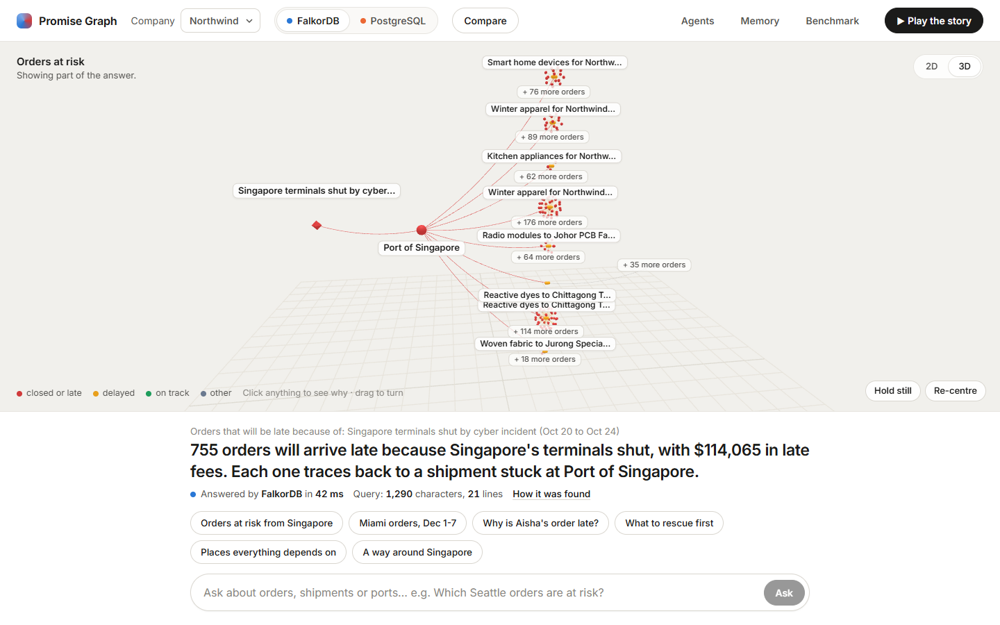
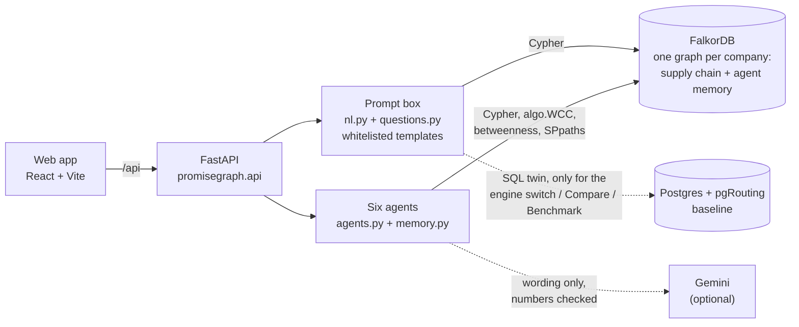

# Promise Graph

**Every customer order is a promise. When a port closes, Promise Graph tells you which promises
just broke, how badly, which few shipments to rescue, and what the rescue costs, with every answer
backed by a path through the graph.**

Graph Hacks (WeMakeDevs x FalkorDB), **Track 2: Agent Memory and Coordination**. Team **Araxys**:
Pranay J Sathish, Kevin Sudhan, Manish Arunkumar, Shyam Nair.

> All data in this repo is **synthetic**. Port, airport and city locations are real public
> geography; every company, carrier, customer and order is made up.



## Status (Oct 17, day 3)

Working and tested (`backend/tests`, 19 integration tests; demo rehearsed end to end in the UI):
* FalkorDB + a Postgres (with pgRouting) baseline in Docker, **one isolated graph per shipper company**
  (demo tenants: Northwind Retail, 20k orders; Lumen Home Co, 3k orders).
* A deterministic generator for a believable supply chain (4 product families, up to 5 supplier tiers,
  25 real ports, 13 airports, 4 regions of DCs), two live disruption scenarios and three past ones.
* **Six agents that hand off through the graph** (Sentinel, Impact Analyst, Rerouter, Finance,
  Verifier, Comms), with a human approval gate, and **graph memory** they read and write:
  episodic (runs, decisions, outcomes), procedural (playbooks), shared state (decision chains).
* The web app: every answer drawn as its own small graph (2D or 3D), a plain-English prompt with an
  engine switch, Compare, Agents (with approval), Memory, Benchmark, and a 30-second story.
* Exact parity: FalkorDB, Postgres and a plain-Python reference return identical rows.
* Concurrency: 8 agent runs across 2 tenants in parallel with 8 readers, chains intact, tenants isolated.
* A fair benchmark (below) and the HTTP API the UI uses ([`docs/api-contract.md`](docs/api-contract.md)).
* One-command run: `docker compose --profile app up` builds the app, starts both databases and loads
  the demo data on first start.

Still to do: public deployment, demo video, blog post, posting the FalkorDB bug report.

## Quick start

### Option 1: one command (needs only Docker)

```bash
docker compose --profile app up -d --build   # first start: ~2 min to build, ~20 s to load the demo data
```

Open **http://localhost:8080**. The FalkorDB Browser is on http://localhost:3300. To get Gemini wording
(optional; numbers never come from it), put `GEMINI_API_KEY=...` in `backend/.env` before starting.
Data lives in Docker volumes, so later starts skip the load. `docker compose --profile app down` stops it.

### Option 2: development (Docker, Python 3.11+, Node 22)

```bash
docker compose up -d                     # FalkorDB on :6379, Browser on http://localhost:3300, Postgres on :5544
cd backend
python -m venv .venv && .venv/Scripts/activate      # macOS/Linux: source .venv/bin/activate
pip install -r requirements.txt
cp .env.example .env                     # optional: add GEMINI_API_KEY for nicer wording (numbers never come from it)
python -m scripts.load                   # both demo tenants + agent memory + seeded history (~15 s)
python -m scripts.parity                 # prove both engines agree with the reference
python -m pytest -q tests                # 19 integration tests (needs the containers)
uvicorn promisegraph.api:app --port 8000 # API: http://localhost:8000/docs
```

In a second terminal:

```bash
cd frontend
npm install
npm run dev                              # http://localhost:5173 (forwards /api to :8000)
```

`python -m scripts.reset_demo` puts the agents' memory back to the three seeded past disruptions
(every run adds to it).

### Deploying

Any machine with Docker: clone the repo, run Option 1, and open port 8080. The databases are bound to
127.0.0.1, so only the app is reachable from outside. The image (`Dockerfile`) is the API and the built
frontend on one origin; point it at another FalkorDB (e.g. FalkorDB Cloud) with `FALKOR_HOST`,
`FALKOR_PORT`, `FALKOR_USERNAME` and `FALKOR_PASSWORD`, and at Postgres with `PG_DSN` (only the
engine switch, Compare and Benchmark need it).

Run the agents from the command line:

```bash
curl -X POST localhost:8000/api/northwind/runs -H "content-type: application/json"      -d '{"event_id": "EV-SGSIN-1020", "requested_by": "Kevin Sudhan"}'
```

Try it: `GET /api/northwind/events/EV-SGSIN-1020/clusters`, or open the FalkorDB Browser at
http://localhost:3300 and run:

```cypher
MATCH (c:Customer {name: 'Aisha Rahman'})-[:PLACED]->(o)-[:FULFILLED_BY]->(s)<-[:FEEDS*1..6]-(up)
RETURN c, o, s, up LIMIT 50
```

## What it looks like

| | |
|---|---|
|  |  |
| **Why is Aisha's order late?** The delay's path through the graph, from the closed port to her order. | **Compare:** the same question on both engines, the same 755 rows, both queries in full. |
|  |  |
| **Agents:** each step reads the previous one from the graph; spending waits for a human. | **Memory:** past disruptions and outcomes the agents recall (Suez: air freight did not pay off). |
|  |  |
| **Benchmark:** real timings as the delay is followed 2 to 8 steps along the supply chain. | **3D:** the same layout lifted into space; orders orbit the shipment they wait on. |

## Architecture



Every agent writes a `Decision` node chained to the previous one and reads its input back from the
graph, so the handoff, the audit trail and the memory the next run recalls are the same nodes. In
production the API also serves the built frontend, so the whole app is one container on one origin.

## Ask in plain English, on either engine

Type a question (or click a suggestion). The backend maps it to **one template from a whitelist**;
an LLM may pick the template and fill its slots, but it never writes a query, and every slot is
checked against real names in the graph. Each template has a Cypher version and an indexed SQL
version that return **the same rows** (`backend/tests/test_questions.py`).

| You ask | Template |
|---|---|
| Which orders are at risk because Singapore closed? / Which Seattle orders are at risk? | `at_risk` |
| Show orders from Miami customers due between Dec 1 and Dec 7 | `orders_window` |
| Why is Aisha Rahman's order late? | `why_late` |
| Which shipments should we rescue first? | `rescue_first` (WCC vs pgRouting) |
| Which ports does everything depend on? | `weak_points` (betweenness vs pgRouting) |
| How do we get goods from Ho Chi Minh City to Venlo without Singapore? | `reroute` (SPpaths vs pgRouting KSP) |

The **engine switch** in the top bar decides which database answers. Every answer shows the exact
query, its length and the time it took; **Compare** runs both back to back. Agents and memory always
run on FalkorDB: the graph is their memory, and the product must not work without it (Rule 3).

Real sweep on the demo data (orders at risk, 20k orders, same rows at every depth): FalkorDB 19-32 ms,
Postgres 25-103 ms. Both jump at 4 steps, where the deep supply chains start; Postgres jumps more.
Full table: [`bench/NOTES.md`](bench/NOTES.md).

## The agents

A run is one response to one disruption. Each agent reads the previous agent's output **from the
graph** and writes a `Decision` node chained after it:

| Agent | Reads | Does (all numbers from Cypher) | Writes |
|---|---|---|---|
| Sentinel | the event | ranks the closed hub by betweenness (Q4), counts direct hits (Q6), **recalls similar past runs** (M1) | `alert`, `recall` |
| Impact Analyst | Sentinel's decision | cascade (Q1) + stranded clusters (Q3) | `impact` + `Cluster` nodes |
| Rerouter | the clusters | fastest and cheapest routes around closed hubs for every root (Q5) | `reroute` + `RouteOption` nodes |
| Finance | clusters + route options + **playbooks** (M2) | prices every plan with the what-if cascade (Q1b), keeps only rescues that save more than they cost | `plan` (needs approval) |
| Verifier | everything above | re-runs impact and plan, re-walks every route lane by lane, blocks on any mismatch | `verification` |
| *human* | the verified plan | approves (cannot be the requester) | `APPROVED_BY` |
| Comms | the approved plan | finds who is still late after the rescue, drafts messages | `message`, `Outcome`, playbook update |

On the demo data (Singapore shut Oct 20-24): 755 promises break ($114,065 in penalties) in 6 clusters
traced to 12 root shipments. Finance proposes rescuing 3 roots by sea for $19,180, saving $68,257 and
406 promises, and rules out air freight because the seeded Suez playbook says it did not pay off. Gemini
only rewrites the wording; any sentence with a number that is not in the facts is thrown away.

## Graph data model

Full model, property tables and the agent-memory contract: [`docs/graph-model.md`](docs/graph-model.md).

```
(Customer)-[:PLACED]->(Order)-[:HAS_PROMISE]->(Promise {due_day, status, penalty_per_day})
(Order)-[:FULFILLED_BY]->(Shipment)-[:USES]->(Leg)-[:FROM|TO]->(Hub)
(Shipment)-[:FEEDS {buffer_days}]->(Shipment)      // B can't leave until A arrives
(Leg)-[:OPERATED_BY]->(Carrier)
(Hub)-[:LANE {mode, days, cost_per_kg}]->(Hub)
(Event {start_day, end_day, backlog_days})-[:AFFECTS]->(Hub)
```

## Queries and algorithms the product depends on

All of them, generated from the code: [`docs/queries.md`](docs/queries.md).

| | What | FalkorDB feature |
|---|---|---|
| Q1 | Which promises a disruption breaks, days late, penalty, hops away | variable-length `FEEDS*0..n`, `reduce()` over the path |
| Q2 | Every shipment it delays | same |
| Q3 | Independent "stranded clusters" and their root shipments | `algo.WCC` |
| Q4 | Chokepoint hubs before anything breaks | `algo.betweenness` |
| Q5 | Fastest and cheapest reroutes avoiding closed hubs | `algo.SPpaths` |
| Q1b | Penalties after a proposed rescue (what-if) | Q1 with overridden starting delays |
| Q6 | Which legs of which shipments the closure hits | single-type pattern comprehensions |
| M1, M2 | Memory recall and playbooks | `Run`/`Decision`/`Outcome`/`Playbook` nodes, lane neighbourhood |

## Benchmark: FalkorDB vs a tuned Postgres, same data, same answers

Details, fairness rules and caveats: [`bench/NOTES.md`](bench/NOTES.md). Raw numbers: [`bench/day1.md`](bench/day1.md).

Singapore closes for 5 days; deepest chains are 7 `FEEDS` hops. Laptop, both engines in Docker
(Postgres 16.9 + pgRouting 3.8).

| Question | 20k orders | 100k orders |
|---|---|---|
| Q1 cascade, 7 hops, **engine time** | FalkorDB 26 ms vs Postgres 45 ms (1.7x) | 111 ms vs 220 ms (2.0x) |
| Q1 cascade, 7 hops, **end to end** | 53 ms vs 42 ms (**Postgres 1.3x faster**) | 196 ms vs 277 ms (1.4x) |
| Q3 stranded clusters, end to end, vs **Postgres + pgRouting** | FalkorDB 135 ms vs 54 ms (**Postgres 2.5x faster**) | 410 ms vs 201 ms (**Postgres 2.0x faster**) |
| Q3 stranded clusters, end to end, vs plain recursive SQL | 135 ms vs 3,714 ms (28x) | 410 ms vs 50,837 ms (124x) |
| Q4 chokepoints, exact betweenness over 121 hubs, end to end | FalkorDB 3.6 ms vs pgRouting 3.5 ms (level) | 3.8 ms vs 4.2 ms (level) |
| Q5 reroutes, **the product's question** (routes of at most 7 lanes), every query the event needs | 12 queries: FalkorDB 59 ms vs pgRouting 75 ms (1.3x) | 26 queries: 154 ms vs 173 ms (1.1x) |
| Q5 reroutes, **plain k shortest paths** (no lane cap), per query | FalkorDB 52 ms, 2 of 12 timed out at 1 s, vs pgRouting 4.8 ms (**pgRouting 11x faster**) | 104 ms, 7 of 26 timed out, vs 4.8 ms (**21x**) |

What this honestly means:
* On the multi-hop cascade, a well-indexed recursive CTE is competitive. FalkorDB's engine is
  1.4-3.2x faster from 20k orders up (2+ hops), but end to end the Python driver eats that lead at
  20k orders (Postgres was ahead at 5-7 hops in this run; level in the previous one). At 100k orders
  FalkorDB is 1.0-1.7x faster end to end.
* On connected components, Postgres with pgRouting's `pgr_connectedComponents` beats our FalkorDB
  version (2.0-2.5x). `algo.WCC` itself takes ~5 ms; most of our time goes into finding and tagging
  the impacted shipments before calling it (see [`bench/NOTES.md`](bench/NOTES.md)). FalkorDB is
  9-124x faster than plain recursive SQL, but that is not the fair baseline, so we do not lead with it.
* On chokepoints, `algo.betweenness` and `pgr_betweennessCentrality` give every hub the same score
  and take about the same time (~4 ms). FalkorDB's default samples only 32 of the 121 hubs, which is
  approximate (9 of the true top 10, in a different order), so the shipped query samples every hub and
  is exact, for ~1-2 ms more.
* On reroutes, FalkorDB is a little faster (1.1-1.9x in total) **only because the product caps routes at
  7 lanes**: `algo.SPpaths` has that cap built in, `pgr_KSP` does not, so the baseline keeps asking for
  more paths until 20 short ones are in. Remove the cap and pgRouting is 11-21x faster, while FalkorDB
  hit its 1 s timeout on 11 of 44 queries.

## Why FalkorDB is load-bearing (Rule 3)

Remove FalkorDB and nothing works: every product endpoint, every agent tool and the agent memory run
on Cypher and FalkorDB graph algorithms. Postgres is used **only** to compare against: the benchmark
scripts and the race features in the UI (the engine switch, Compare and Benchmark, served by `/ask`
with `engine=postgres`, `/compare`, `/sweep` and `/race`). Its queries are SQL twins of the product's
Cypher (cascade, two clusters baselines, and pgRouting chokepoint/reroute baselines). Agents and
memory never touch it.

## FalkorDB bugs we hit

Two planner bugs made queries return **no rows, silently**, inside the cascade and the "why is this order
late" path. The parity test against Postgres and a plain-Python reference caught both (FalkorDB 0 rows,
the others 1,240 and 2). The product uses workarounds that plan correctly. Minimal repro:
`python -m scripts.repro_falkordb` (from `backend/`; exits 1 while they reproduce). Write-up:
[`docs/falkordb-bug-report.md`](docs/falkordb-bug-report.md). One of them is already known upstream
([FalkorDB#2972](https://github.com/FalkorDB/FalkorDB/issues/2972), fix in progress in
[FalkorDB#3264](https://github.com/FalkorDB/FalkorDB/pull/3264)); the other is new.

## Rules checklist

| Rule | Where |
|---|---|
| FalkorDB is the primary database and the product breaks without it | [Why FalkorDB is load-bearing](#why-falkordb-is-load-bearing-rule-3) |
| Allowed data only | Everything is synthetic (`backend/promisegraph/datagen.py`); real geography only |
| Public repo, README with setup instructions | [Quick start](#quick-start) (one command, or step by step) |
| Graph data model | [Graph data model](#graph-data-model), full: [`docs/graph-model.md`](docs/graph-model.md) |
| Cypher queries and graph algorithms | [Queries and algorithms](#queries-and-algorithms-the-product-depends-on), all of them: [`docs/queries.md`](docs/queries.md) |
| Live deployment, or complete local setup | [Deploying](#deploying) / [Option 1](#option-1-one-command-needs-only-docker) |
| Demo video | *link to come* |
| Track | Track 2: Agent Memory and Coordination |
| AI tools disclosed | [Disclosure](#disclosure) |

## Disclosure

* **AI assistance:** we used Claude Code (Anthropic) as a coding assistant for scaffolding, the data
  generator, queries, agents and benchmark scripts. Every query and design decision is reviewed by the
  team, and every teammate can explain the model, queries and architecture.
* **AI in the product:** the agents call Google Gemini only to rewrite their findings into plain
  sentences and to draft customer messages. All figures come from Cypher; output containing a number
  that is not in the given facts is discarded, and without a key the agents use templates.
* **Reuse:** no code from any earlier project. Some design ideas (a policy gate where a requester
  cannot approve their own action, an append-only audit trail) come from Kevin's earlier, unrelated
  `domain-specific-harness` repo and are being re-implemented from scratch here.

## Repo layout

```
docker-compose.yml          FalkorDB (product) + Postgres with pgRouting (benchmark baseline only);
                            profile "app" adds the app container
Dockerfile                  the app: built frontend + API in one image, loads the demo data on first start
backend/promisegraph/       datagen.py, world.py, falkor_store.py (product queries), questions.py + nl.py
                            (prompt box: whitelisted templates, Cypher/SQL twins), story.py, memory.py (agent memory),
                            agents.py (the six agents), views.py (graph views for the UI), llm.py (wording only),
                            history.py (seeded synthetic history), api.py, pg_store.py (baseline only)
backend/scripts/            load.py, parity.py, bench.py, concurrency.py, export_queries.py, reset_demo.py,
                            repro_falkordb.py
backend/tests/              integration tests (parity, agents, views, LLM guard)
docs/                       graph-model.md, queries.md, api-contract.md, TASKS.md, falkordb-bug-report.md,
                            screenshots/
bench/                      results and NOTES.md
frontend/                   React + Vite app (2D panel, engine scoreboard, 3D view)
```
