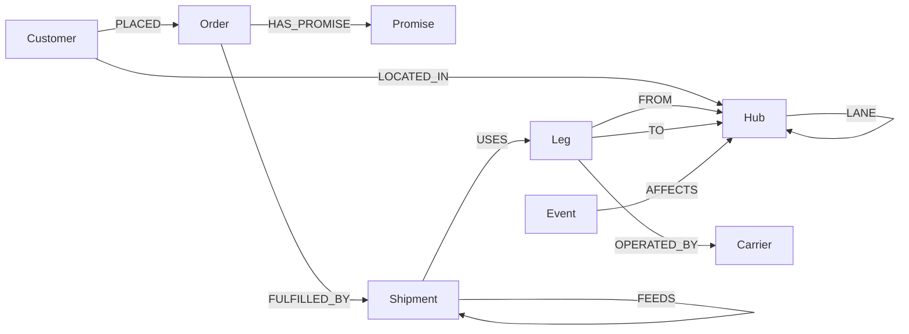
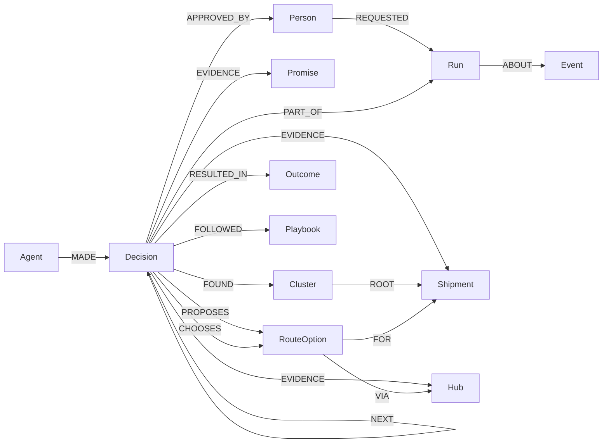

# Graph data model

One FalkorDB graph per shipper company (tenant): `promise_<tenant>`, e.g. `promise_northwind`.
Tenants never share nodes, so one company's agents cannot see another company's data.

All dates are integer **day numbers** (day 0 = 2026-01-01) so date maths is plain integer
maths in every engine. `Promise.due_date` also stores the ISO date for humans.

## World and promises (built, loaded, tested)



| Node | Key properties | What it is |
|---|---|---|
| `Hub` | `id` (UN/LOCODE or own code), `name`, `kind` (port, airport, supplier, factory, dc_national, dc_regional, zone), `country`, `lat`, `lon` | Any place goods sit or pass through |
| `Carrier` | `id`, `name`, `mode` | Fictional ocean, air, truck, rail and parcel carriers |
| `Customer` | `id`, `name`, `tier` (consumer, plus, business), `city` | Who we promised |
| `Order` | `id`, `placed_day`, `value_usd`, `family`, `channel` | What they bought |
| `Promise` | `id`, `due_day`, `due_date`, `status` (active, kept), `penalty_per_day` | The delivery date we committed to, and what each late day costs |
| `Shipment` | `id`, `stage` (supply, inbound, transfer, lastmile), `tier`, `mode`, `depart_day`, `eta_day`, `weight_kg`, `value_usd`, `description` | One movement of goods |
| `Leg` | `id`, `seq`, `mode`, `depart_day`, `arrive_day` | One hop of a shipment between two hubs |
| `Event` | `id`, `type`, `name`, `start_day`, `end_day`, `backlog_days`, `severity` | A disruption (port closure, strike) |

| Edge | Properties | Meaning |
|---|---|---|
| `FEEDS` | `buffer_days` | B cannot leave until A's goods arrive. `buffer_days` = B.depart_day - A.eta_day: the slack that soaks up a delay before it passes on |
| `LANE` | `mode`, `days`, `cost_per_kg` | A route a carrier can run between two hubs. Used for reroutes and chokepoints |
| `AFFECTS` | | Which hubs a disruption shuts |
| the rest | | Plain structure: who ordered what, which legs a shipment uses, who operates them |

### Why this is a graph problem

* **Cascades.** A closed port delays a component, which delays a container, which delays a DC
  transfer, which breaks a customer promise 4 to 6 `FEEDS` hops away. On our synthetic data,
  stopping at 2 hops misses 37% of the broken promises (20k orders: 471 at depth 2 vs 755 at full depth).
* **Delay that shrinks along the path.** Each `FEEDS` edge carries its own buffer, so the delay at
  a shipment depends on the path taken. Cypher computes it with `reduce()` over `relationships(path)`.
* **Clusters.** Weakly Connected Components split the impact into independent problems with their own
  root shipments.
* **Chokepoints and reroutes.** Betweenness centrality and weighted k-shortest paths over `LANE`.
* **Isolation.** One graph per tenant.

## Agent memory (Track 2): built Oct 16



| Node | Key properties | What it is |
|---|---|---|
| `Agent` | `id` (sentinel, impact_analyst, rerouter, finance, verifier, comms), `name`, `role` | One of the six agents |
| `Person` | `name` | A human who requests runs or approves plans |
| `Run` | `id`, `event_id`, `status` (running, awaiting_approval, done, failed), `requested_by`, `created_at` | One episode: the agents' response to one disruption |
| `Decision` | `id`, `agent`, `kind` (alert, recall, impact, reroute, plan, verification, message), `summary`, `explanation`, `explanation_source` (template or gemini), `status`, `requires_approval`, `numbers` (JSON), `seq`, `created_at` | One agent's output; the unit of handoff |
| `Cluster` | `id`, `n`, `shipments`, `promises_at_risk`, `penalty_usd` | A stranded cluster found by WCC |
| `RouteOption` | `id`, `root`, `option` (cheapest, fastest), `hubs`, `modes`, `days`, `usd_per_kg`, `cost_usd`, `new_eta_day`, `residual_delay` | A reroute the Rerouter proposed |
| `Outcome` | `summary`, `cost_usd`, `saved_usd`, `promises_saved`, `worked`, `expected` | What a plan achieved (`expected: false`, a real outcome) or is forecast to (`expected: true`) |
| `Playbook` | `id`, `event_type`, `trigger`, `action`, `uses`, `successes` | A learned rule, updated every time a plan follows it |

| Memory type | Lives in | Where it changes behaviour |
|---|---|---|
| Semantic | The world graph above | Every query |
| Episodic | `Run`, `Decision`, `Outcome` | The Sentinel recalls past runs at the same hub, one lane away, or of the same kind, with their outcome |
| Procedural | `Playbook`, its track record via `FOLLOWED` plans and their real `Outcome`s | Finance scales each option's expected saving by its habit's track record (actual / expected saving): air freight for full containers 28% (Suez), sea reroutes 95%. On LA / Long Beach this flips the plan from air freight to no rescue |
| Shared state / handoffs | `Decision`-`NEXT`->`Decision` inside a `Run`, plus `Cluster` and `RouteOption` nodes | The Rerouter reads clusters from the Impact Analyst's decision; Finance reads route options from the Rerouter's |
| Per tenant | One graph per company | `northwind` and `lumen` never share a node; `scripts/concurrency.py` checks it |

Memory influence and the comparison (Oct 17):

```
(plan:Decision)-[:USED_MEMORY {realization, effect: 'changed'|'checked'}]->(:Playbook)
(past:Decision)-[:FOLLOWED]->(:Playbook), (past)-[:RESULTED_IN]->(:Outcome {expected: false})
(:Run {memory: 'off'})-[:COUNTERFACTUAL_OF]->(:Run)      // the same analysis, memory switched off
Decision.ms                                              // duration of the agent step that wrote it
```

A seeded plan's `numbers.saved_usd` is the saving it expected when approved; its outcome's `saved_usd`
is what it actually saved. Recall only counts disruptions that started before the current one.

The three past disruptions (Colombo Apr 2026, Port Klang Jun 2026, Suez Jul 2026) and their runs are
**seeded synthetic history** (`backend/promisegraph/history.py`), written through the same memory
functions the live agents use.

Rules the agents follow (enforced in code, tested in `backend/tests`):
1. **Numbers come from Cypher, never from the LLM.** Gemini only rewrites wording, in the background,
   and its text is discarded if it contains any number that is not in the facts it was given.
2. Every `Decision` links to the nodes that justify it (`EVIDENCE`). The Verifier re-runs the impact and
   the plan, re-walks every rescue route lane by lane, and blocks the plan if anything disagrees.
3. Nothing that spends money happens without an `APPROVED_BY` edge to a human, and nobody can approve
   their own request.
